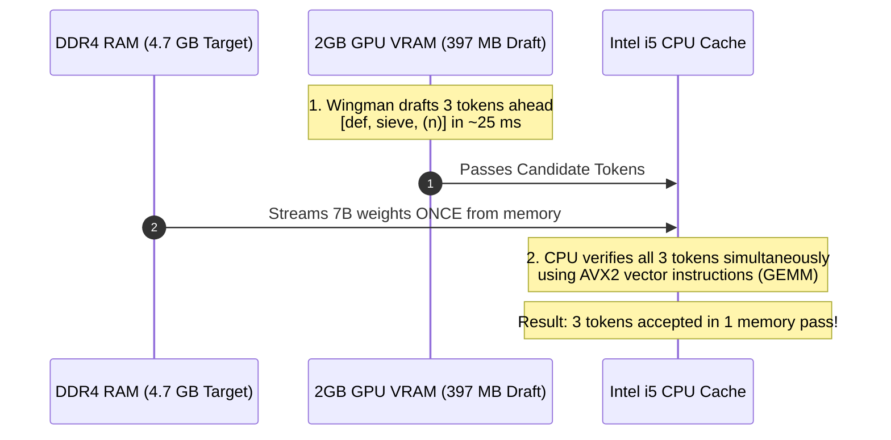

<div align="center">
  
  <h1>WingLLM</h1>
  <p><strong>Heterogeneous Speculative Decoding Co-Processor for Budget GPUs & Low-VRAM Hardware</strong></p>
  <p>
    <a href="https://www.xdlabs.io/work/wingllm"><strong>xdlabs.io/work/wingllm →</strong></a> •
    <a href="https://huggingface.co/bennett-xdlabs/wingllm"><strong>Hugging Face Hub →</strong></a> •
    <a href="https://gitlab.com/xdlabs-io/wingllm"><strong>GitLab →</strong></a>
  </p>
  <p>
    <a href="https://golang.org"></a>
    <a href="https://opensource.org/licenses/MIT"></a>
  </p>
</div>

> **Turn your 2 GB GPU into a high-speed speculative drafting engine. Double your local AI inference speeds without buying expensive hardware.**

---

## The Problem: The 2 GB VRAM Trap

Millions of developers worldwide code on everyday machines: laptops with MX350/GTX 1050 cards, mini-PCs, or workstations with 2 GB GPUs (e.g. Quadro P620). 

Modern 7B and 8B LLMs (like Qwen 2.5 Coder 7B or Llama 3.1 8B) require 4.5 GB to 5 GB of VRAM. Because they cannot fit into 2 GB of video memory, developers are forced to run them **100% on the CPU**—suffering through slow generation speeds (**1.2 to 2.5 tokens per second**) while their GPU sits 90% idle.

---

## The Solution: The Wingman Architecture

**WingLLM** pairs your heavy target model with an ultra-lightweight "wingman" draft model:

1. **Target Model (4.7 GB)** is loaded into your **CPU System RAM** (where you have 16 GB to 32 GB of capacity).
2. **Wingman Draft Model (0.5B / ~397 MB)** is pinned directly into your **2 GB GPU VRAM via CUDA**.
3. The 2 GB GPU drafts 3 to 4 tokens ahead in milliseconds; the CPU verifies all of them in a single parallel batch pass.



---

## Empirical Benchmark: Confirmed on Real Hardware

Tested on an **Intel Core i5-8500T (6 cores, 32GB RAM)** paired with an **NVIDIA Quadro P620 (2GB VRAM)**:

| Mode | Target Model | Draft Model | Generation Speed | Total Time (32 tok) | Speedup |
| :--- | :--- | :--- | :--- | :--- | :--- |
| **Baseline (Pure CPU)** | Qwen 2.5 Coder 7B | *None* | **1.29 tok/s** | 24.76 s | **1.0×** |
| **WingLLM (Speculative)** | Qwen 2.5 Coder 7B | Qwen 2.5 Coder 0.5B | **2.54 tok/s** | 12.62 s | **1.97× FASTER** |

---

## Features

- **Zero Configuration**: Scans your local Ollama manifests (`~/.ollama/models`) and automatically discovers GGUF model blobs.
- **Strict Pair Curation**: Prevents tokenizer vocabulary mismatch crashes by only matching models with verified identical tokenizers (e.g., Qwen 2.5 0.5B $\leftrightarrow$ 7B/14B/32B).
- **Windows WDDM Sentinel**: Monitors live GPU video memory to ensure the draft model and KV cache never cross the physical threshold that causes Windows to page into host RAM.
- **OpenAI-Compatible API**: Exposes standard endpoints (`/v1/chat/completions`, `/v1/models`) ready for VS Code Continue, Cline, Obsidian, or curl.
- **Embedded Web Dashboard**: Live telemetry at `http://localhost:8080/`.

---

## Quickstart

### 1. One-Line Install

**macOS & Linux**:
```bash
curl -fsSL https://huggingface.co/bennett-xdlabs/wingllm/raw/main/install.sh | bash
```

**Windows (PowerShell)**:
```powershell
irm https://huggingface.co/bennett-xdlabs/wingllm/raw/main/install.ps1 | iex
```

**Direct Binary Downloads**:
* Windows: [`wingllm.exe`](https://huggingface.co/bennett-xdlabs/wingllm/resolve/main/wingllm.exe)
* macOS (Apple Silicon): [`wingllm-darwin-arm64`](https://huggingface.co/bennett-xdlabs/wingllm/resolve/main/wingllm-darwin-arm64)
* macOS (Intel): [`wingllm-darwin-amd64`](https://huggingface.co/bennett-xdlabs/wingllm/resolve/main/wingllm-darwin-amd64)
* Linux (x86_64): [`wingllm-linux-amd64`](https://huggingface.co/bennett-xdlabs/wingllm/resolve/main/wingllm-linux-amd64)

### 2. Check Available Models & Pairings
```bash
wingllm list
```
*Output:*
```
--- Discovered Local Models ---

[TARGET MODELS - CPU System RAM]:
  • qwen2.5-coder:7b               (4.7 GB) [Family: qwen2.5]
  • xdlabs:30b                     (18.0 GB) [Family: qwen2.5]

[WINGMAN DRAFT MODELS - 2GB GPU VRAM]:
  • qwen2.5-coder:0.5b             (397 MB) [Family: qwen2.5]

[AUTO-RECOMMENDED PAIRINGS]:
  ✔ wingllm serve qwen2.5-coder:7b -> drafts with qwen2.5-coder:0.5b (qwen2.5)
```

### 3. Launch the Server
```bash
wingllm serve qwen2.5-coder:7b
```
*(If you don't have the 0.5B draft model installed yet, WingLLM will automatically pull it for you via Ollama and immediately start serving!)*
WingLLM will:
1. Verify free VRAM headroom on your GPU.
2. Initialize `qwen2.5-coder:7b` in system RAM.
3. Pin `qwen2.5-coder:0.5b` into your 2 GB GPU.
4. Start serving at `http://localhost:8080/v1`.

---

## Connecting to Your IDE & AI Agents

### VS Code (Continue Extension)
Run the 1-click connector:
```bash
wingllm connect vscode
```
*Or add manually to `~/.continue/config.json`:*
```json
{
  "models": [
    {
      "title": "WingLLM (Qwen 7B Turbo)",
      "provider": "openai",
      "model": "qwen2.5-coder:7b",
      "apiBase": "http://localhost:8080/v1"
    }
  ]
}
```

### Model Context Protocol (MCP) for Claude Code / Cursor / Agents
WingLLM includes a built-in MCP server for AI coding assistants.

Add to your MCP configuration (e.g. `claude_desktop_config.json` or `.cursor/mcp.json`):
```json
{
  "mcpServers": {
    "wingllm": {
      "command": "wingllm",
      "args": ["mcp"]
    }
  }
}
```
Available MCP Tools:
- `wingllm_vram`: Check real-time GPU VRAM safety budget.
- `wingllm_models`: List discovered models and auto-curated draft pairs.
- `wingllm_status`: Inspect live engine throughput and health.

---

## License
MIT License. Built for developers who do not have lab-grade hardware.
